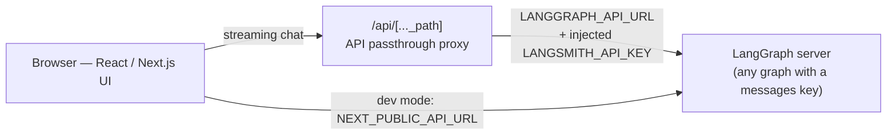

# Agent Chat UI

> A polished, drop-in chat frontend for **any LangGraph server**. Point it at a deployment URL, pick your graph or assistant, and start chatting — live token streaming, artifact side panels, thread management, and production-grade auth are all built in.

No custom frontend to build for every agent: Agent Chat UI speaks the LangGraph streaming protocol to any server exposing a `messages` key, works locally or against a LangGraph Cloud deployment, and ships a server-side API passthrough so your LangSmith key never touches the browser in production.

## ✨ Features

- 💬 Chat with **any LangGraph server** with a `messages` key — local dev or production deployment
- ⚡ Live **token streaming** via the LangGraph SDK (`on_chat_model_stream`)
- 🧩 **Artifact rendering** in a side panel (obtainable from `thread.meta.artifact`)
- 🧵 Thread management with visibility controls — hide streaming (`langsmith:nostream` tag) or hide messages entirely (`do-not-render-` prefix)
- 🔐 Production **API passthrough** proxy: `LANGGRAPH_API_URL` + `LANGSMITH_API_KEY` injected server-side, users never need their own key
- 🔑 Flexible auth: LangSmith API key, Agent Builder toggle, or custom bearer tokens in `useTypedStream`
- 🎥 Video setup guide included

## 🏗️ Architecture

